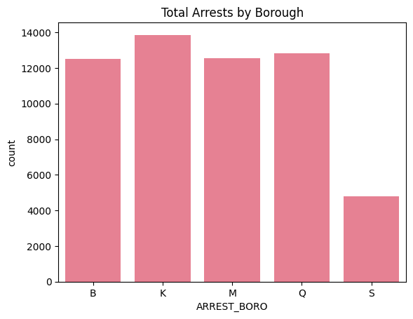
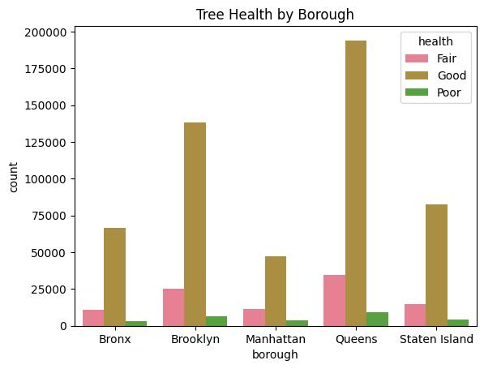

# NYC Urban Life Analysis: Arrests, Restaurant Inspections and Street Trees

Three NYC Open Data datasets, one question: how do public safety, food safety and street trees differ across the five boroughs? The data is loaded into SQLite and queried with SQL (CTEs and window functions), then charted in Python.



## Data

| Dataset | Contents |
|---|---|
| NYPD Arrests | Arrest date, offense, borough, demographics |
| DOHMH Restaurant Inspections | Inspection date, grade, violations, cuisine, borough |
| 2015 Street Tree Census | Species, trunk diameter, health, borough |

All three are on [NYC Open Data](https://opendata.cityofnewyork.us/). The CSVs are too large for this repo, so download them and save them as `NYPD_Arrests.csv`, `Restaurant_Inspection.csv` and `Street_Tree_Census_2015.csv`.

## Questions and queries

| File | Question |
|---|---|
| `queries/q1_first_look_arrests.sql` | First look at the arrests table |
| `queries/q2_unhealthy_trees_by_borough.sql` | Which boroughs have more than 50 trees in poor health? |
| `queries/q3_monthly_arrests_by_crime_type.sql` | Monthly 2024 arrests for robbery, burglary, assault and grand larceny |
| `queries/q4_trees_vs_restaurants_by_borough.sql` | Tree counts and trunk size compared with restaurant counts by borough |
| `queries/q5_arrests_by_season.sql` | Arrests by season |
| `queries/q6_restaurant_grade_changes.sql` | Restaurants whose grade changed between inspections (`LAG` window function) |

Each file holds the SQL as a Python string plus the `pd.read_sql_query` call that runs it.

## Charts (`images/`)

- Arrests: `arrests_by_borough`, `borough_distribution_bar_plot`, `top_10_offense_descriptions`
- Restaurants: `count_grades_per_cuisine`, `number_of_restaurants_by_borough_and_grade`, `top_10_cuisines_by_inspection_count`, `q1_results`, `q2_results`
- Trees: `tree_health_by_borough`, `tree_health_distribution_stacked_bar_chart`, `tree_species_diversity_top_10_pie_chart`



## How to run

```bash
pip install pandas matplotlib seaborn
```

```python
import sqlite3
import pandas as pd

conn = sqlite3.connect(":memory:")
pd.read_csv("NYPD_Arrests.csv").to_sql("arrests", conn, index=False)
pd.read_csv("Restaurant_Inspection.csv").to_sql("restaurants", conn, index=False)
pd.read_csv("Street_Tree_Census_2015.csv").to_sql("trees", conn, index=False)
```

Then paste a query from any file in `queries/` and run it with `pd.read_sql_query`.

## Next steps

- Add census demographics and transit data to explain borough differences
- Forecast restaurant grade drops from past inspection history

Author: Muhammad Ehtesham · [LinkedIn](https://www.linkedin.com/in/muhammad-ehtesham-dsa)
